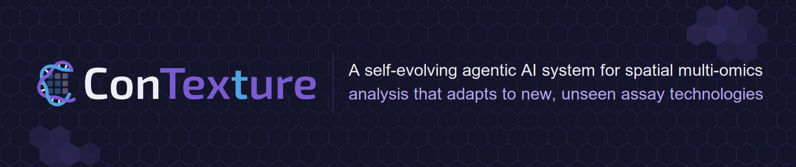
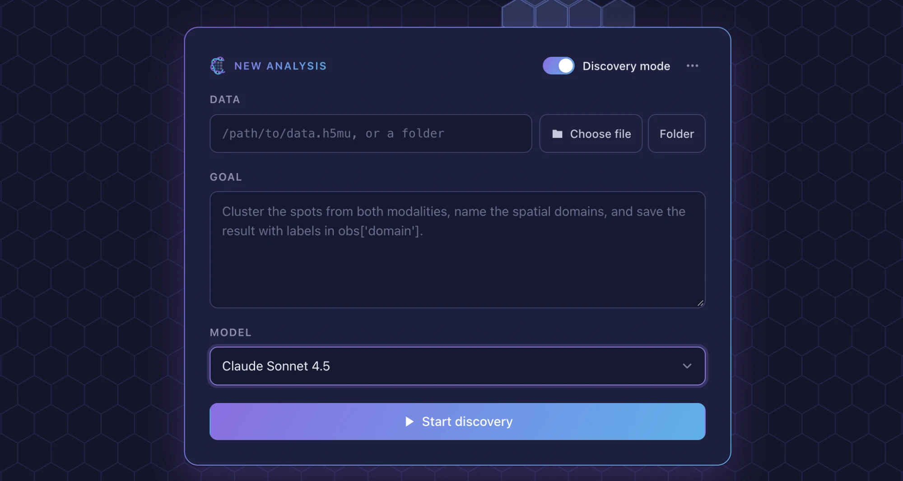

<p align="center"></p>

## Installation

Install [uv](https://docs.astral.sh/uv/) first:

```bash
curl -LsSf https://astral.sh/uv/install.sh | sh
```

Install ConTexture:

```bash
uv tool install git+https://github.com/anthony-qu/ConTexture
```

## Try our Web UI

In terminal:

```bash
contexture
```



Pick a data file (`.h5ad` or `.h5mu`, or a folder of them), describe the goal, choose a model,
and start. The first time, the page asks for an API key from a model provider; it is saved on
your computer. **Discovery mode** turns on method discovery and skill evolution. Each run gets
its own folder in `contexture-runs/`, inside the folder you started `contexture` from.

## Or run it in the terminal

```bash
contexture run sample.h5ad "Cluster the spots, name the spatial domains, and save the result with the labels in obs['domain']."
```

| option | default | what it sets |
| --- | --- | --- |
| `--output-dir` | `contexture-output/` in the current folder | where results are written |
| `--model` | a model your saved key can use | any [LiteLLM](https://docs.litellm.ai/) model name |
| `--max-turns` | `30` | the turn budget for the run |
| `--discovery` | off | method discovery |
| `--evolve` | off | skill evolution (needs `--discovery`) |
| `--discovery-model` | the same as `--model` | the model for the data reporter, the skill maker and the method discovery agent |

